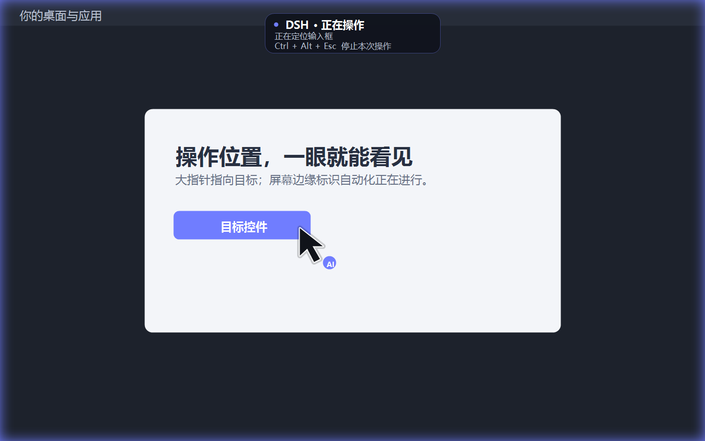

# DSH Desktop Control

为 Windows 上的 DSH 桌面操作增加可见反馈和执行校验：**大黑指针、屏幕边缘发光、真实状态提示、停止热键，以及 UI Automation 控件定位**。



上图为使用原生渲染器生成的效果示意，不是实际应用操作录像。

## 安装与试用

下载 [Releases](https://github.com/chanhaoxian5-ship-it/dsh-desktop-control/releases) 中的 `.tgz`，通过 DSH 正常安装：

```powershell
dsh plugin --profile desktop add 'D:/下载目录/dsh-desktop-control-0.1.0.tgz'
```

重新启动 DSH，在新对话中输入：

> 使用 desktop-control，先预览 6 秒可视提示，不执行任何输入或点击。

然后针对一个明确的应用任务使用 `desktop-control`。本包提供新入口，**不会覆盖旧 computer-use 技能，也不会给旧 cu.ps1 或其他工具的操作自动加特效**。

要求：Windows 10/11、.NET Framework 4.8、Node >=22、DSH `>=0.2.1-rc.5 <0.3.0`，profile 提供 tools/skills 服务。发布包带自编译的原生程序，不依赖 Codex、Sky 或常驻远程服务。

不安装插件也可从源码目录预览：

```powershell
pwsh -NoProfile -File scripts/preview.ps1 -Seconds 8
```

预览只移动合成的可视指针，不移动真实鼠标，不点击或输入。按 `Ctrl+Alt+Esc` 退出。

## 操作体验

- 大黑指针配 AI 标记；UIA 操作时指向目标控件，鼠标动作时跟随实际位置。
- 屏幕边缘紫蓝光晕，覆盖各显示器；不改变系统鼠标主题。
- 状态分为准备、操作中、已发送、已核对和停止，依据真实动作结果显示。
- 提示层使用点击穿透和不激活窗口，不把用户输入截走。
- 按 `Ctrl+Alt+Esc` 或调用 `desktop_stop` 取消当前请求；已发出的应用动作不能撤销。
- 控制器持续发送心跳，断联后提示层自行退出；动作后关闭窗口并清理会话状态。

## 执行逻辑

| 工具 | 行为 |
| --- | --- |
| desktop_observe | 列窗口、查看前台、读取 UIA 控件、截屏 |
| desktop_action | 切换窗口、控件调用/写入、鼠标键盘动作 |
| desktop_stop | 请求停止本工作区的动作与提示层，可与正在执行的动作并发 |
| desktop_preview | 短暂预览视觉反馈，不发送输入 |

每次动作绑定窗口句柄和进程 ID；可额外约束标题与进程名。UIA 定位须唯一、启用且可见，控件中心不能被其他窗口遮挡；定位失效或不支持操作模式时报错，不静默改成坐标点击。

坐标、拖动、滚轮与键盘输入要求目标在前台，坐标还须落在目标窗口内且未被覆盖。系统拒绝焦点时停止，不向其他应用继续输入。支持左右/中键、单双击、Unicode 输入及常用快捷键；拖动和快捷键在正常取消路径释放按下状态。

`set-value` 回读值；`invoke` 可传 `expectText` 观察预期文字。返回 `delivery: sent/invoked` 仅代表动作发出，不能解释为业务成功。没有指定结果检查时返回 `applicationOutcome: not-verified`。中断/超时后的结果可能未知，不自动重试。

## 截图与数据

截图默认由 Node 保存到 `%LOCALAPPDATA%/DshDesktopControl/captures`，不放进源码或项目仓库；指定 outPath 时遵循该路径且不覆盖已有文件。工具返回绝对路径、尺寸和虚拟桌面 offset，随后通过 DSH 的 read_image 查看，遵循其模型图像能力检查。

向模型读取截图可能使用当前模型服务。本包不会主动上传截图。提示层会请求 Windows 排除捕获；是否接受由 `captureExcluded` 返回。本插件正常在动作后清理提示层，再进行下一次观察。

会话文件默认位于当前任务工作区 `.dsh-desktop-runtime/sessions`，仅包含动作标签、窗口/进程状态与心跳，不保存输入文本。可用 `DSH_DESKTOP_STATE_DIR` 指定另一个控制器与原生进程均可读写的目录。目录不可访问时停止，不修改 ACL 或绕过系统限制。

## 开发与验证

```powershell
npm run build
npm test
npm run test:native
```

build 使用 Windows 自带 .NET Framework C# 编译器。普通测试不操作桌面；`test:native` 会打开自己的独立测试窗口，执行 UIA 填写/按钮调用、取消和提示层检查，然后关闭，不测试其他应用。

已在本机验证：UIA 写入回读、按钮结果、过期 PID 拦截、坐标/前台守卫、焦点保留、命中检测穿透、取消、心跳过期退出、会话清理和截图文件。DSH SDK 工具/技能注册在隔离运行时验证。CI 只构建、单元测试和检查打包，不等于真实桌面验收。

尚未验收：日常 DSH 模型完整调用、多显示器/混合 DPI 设备、所有应用的 UIA 兼容性及长时间运行。UIA 有 160 节点/6 层读取上限；复杂浏览器、管理员窗口、安全桌面、受保护内容可能不可用。密码控件不会读取或填写。

## 来源与许可证

独立实现，MIT 许可。利用 Windows 公开的 UI Automation、SendInput、分层窗口和捕获接口。没有复制 Codex 的程序、客户端、资源、私有通信或授权实现，也不提供 Codex 的应用授权系统。

接口依据：[分层窗口与点击穿透](https://learn.microsoft.com/en-us/windows/win32/winmsg/window-features)、[窗口扩展样式](https://learn.microsoft.com/en-us/windows/win32/winmsg/extended-window-styles)。
